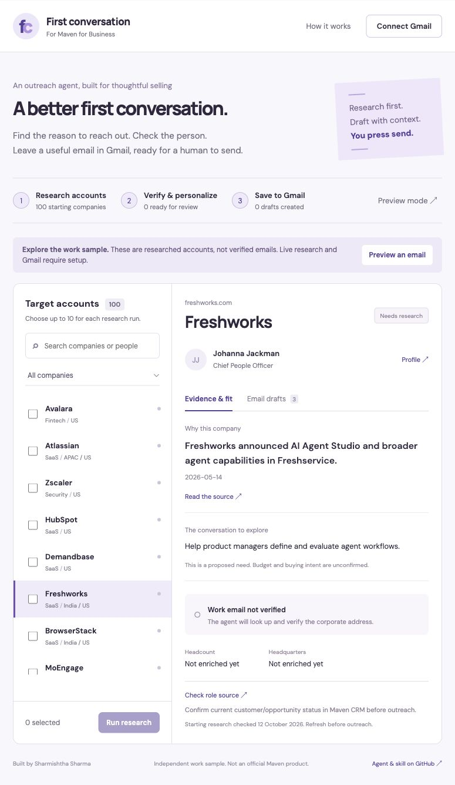

# First conversation

**An outreach agent for Maven for Business, built by Sharmishtha Sharma.**

[Open the web app](https://tangible-wren-154.convex.site) · [Read the reusable skill](skills/maven-outreach/SKILL.md)

A useful first email starts with a reason to contact someone. This work sample turns a curated list of 100 companies into a workflow: read the evidence, confirm a sponsor, verify their work email, write a three-message sequence, and save a reviewed message to the user's own Gmail drafts.

**Current public version is an interactive preview.** Search all 100 companies, inspect sources and edit sample emails. Google sign-in, paid research and live Gmail creation require the owner setup below. No addresses in the starting list are claimed to be verified. No email has been sent by this app.



## What the agent does

1. Takes up to 10 of the 100 starting accounts per run.
2. Reads the supplied public company, role and signal pages. Confirms exact supporting quotations for both the named person and a distinct learning signal.
3. Uses Hunter to find and verify the corporate email, and enrich company information when available.
4. Writes an opening email, a useful follow-up and a closing message, with Maven's offer tied to a proposed learning need.
5. Holds incomplete or uncertain leads for attention. Only a provider result marked valid, not catch-all/disposable/webmail, and dated within 30 days is eligible.
6. Lets a signed-in user review and edit all messages, connect the same Gmail account, and create the selected message as a draft. The user sends it in Gmail.

The agent uses Convex Agent for its research thread. A portable `SKILL.md` describes the same workflow for an assistant with the necessary tools. The website calls the implementation directly; it does not need a skill installed in the visitor's ChatGPT or Codex.

## Honest boundaries

- This version researches **the curated list**, not arbitrary companies. Some sources are old, unavailable, PDF-only or incomplete; those accounts can stay on hold. It does not promise 100 verified contacts.
- A learning signal is evidence to investigate, not proof of a buying budget or intent. A valid email is not a guarantee of delivery, current employment or consent.
- Sample emails in preview are templates, not a claim that live AI research ran.
- Follow-ups are drafts only. There is no sending, scheduling, reply tracking or automatic nurture campaign.
- Each Gmail attempt is recorded before the request. Repeat clicks do not create another draft for that account/message/mailbox. An uncertain timeout blocks retry until an operator checks Gmail; there is no automated reconciliation yet.
- Google does not provide a Gmail draft-only permission. `gmail.compose` also permits sending; this app implements **only draft creation**, with no send endpoint. Access tokens stay in browser memory and pass to the backend for the requested action; no refresh token is stored.
- Provider and Gmail integrations are implemented but have not been tested against paid provider credentials or an authorized Gmail account. See [verification notes](docs/verification.md).
- This is an independent work sample, not an official Maven product. Do not represent yourself as Maven without authorization.

## Setup

### 1. Run the app

```sh
npm ci
npx convex dev --configure new --dev-deployment cloud --once
npm run dev
```

Convex writes `.env.local`. Without `VITE_GOOGLE_CLIENT_ID`, the app deliberately opens in preview mode. Use a separate Convex project; do not point it at an unrelated app.

### 2. Connect Google

Create a Google Cloud OAuth client of type **Web application**, enable the Gmail API, and configure the consent screen. For a private demo, add intended users as test users. A broadly available external app using Gmail's restricted permissions may require Google's verification and security review; a GitHub link does not bypass this.

Add these URLs, substituting your own deployment:

- Authorized JavaScript origin: `https://YOUR-DEPLOYMENT.convex.site`
- Authorized redirect URI: `https://YOUR-DEPLOYMENT.convex.site/api/auth/callback/google`
- For local development, also add the actual localhost origin and your development deployment's callback URL.

Set **server variables in the Convex dashboard** for the appropriate deployment:

| Variable             | Value                                                                   |
| -------------------- | ----------------------------------------------------------------------- |
| `AUTH_GOOGLE_ID`     | Google client ID                                                        |
| `AUTH_GOOGLE_SECRET` | Google client secret; never a `VITE_` variable                          |
| `SITE_URL`           | Your app's full `https://…convex.site` URL                              |
| `ALLOWED_EMAILS`     | Comma-separated Google emails permitted to use live research and drafts |

Generate the auth signing keys once, without printing secrets:

```sh
SITE_URL=https://YOUR-DEPLOYMENT.convex.site node scripts/setup-auth.mjs --prod
```

Omit `--prod` for the development deployment. This configures `JWT_PRIVATE_KEY`, `JWKS` and `SITE_URL`. Re-running rotates signing keys and signs out existing sessions.

Add the **public** Google client ID to local `.env.local` for the frontend build:

```dotenv
VITE_GOOGLE_CLIENT_ID=YOUR-CLIENT-ID.apps.googleusercontent.com
```

Never commit `.env.local`, keys, access tokens or enriched private account data.

### 3. Enable research after reviewing costs

Set `HUNTER_API_KEY` in the Convex dashboard. This app calls Hunter's email finder, email verifier and optional company enrichment APIs. Review your provider plan and quotas first.

AI defaults to the Convex AI Gateway with `AI_MODEL=openai/gpt-4.1-mini`; ensure the deployment supports the gateway and review its usage charges. Alternatively set server-only `OPENAI_API_KEY` and optionally `OPENAI_MODEL=gpt-4.1-mini`.

Only after approving the providers and costs, set `ENABLE_PAID_WORKFLOWS=true`. It is off by default. Limits are 10 companies per run and 100 per signed-in account in a rolling 24-hour period. These limits are not a monetary spending cap; use provider billing controls too.

### 4. Deploy

```sh
npm test
npm run build
npm run deploy
```

Deployment uses Convex for both the backend and static hosting. The deploy command builds with the correct production `VITE_CONVEX_URL`. A GitHub push does not deploy.

### 5. Confirm the real workflow

Sign in with an allowed Google account. Research one company first. Verify its sources and email result, edit the sequence and check the review box. Connect the same Gmail account, create a draft and confirm it exists in that account's Drafts folder. Do not send during testing. Check that a second click cannot duplicate it and that another account cannot access the first account's records.

## Install the reusable skill

Copy `skills/maven-outreach` into your assistant's skills directory (for Codex, `$CODEX_HOME/skills/maven-outreach`) or ask its skill installer to install that folder from this repository. Then invoke `$maven-outreach`. The assistant still needs research, verified-email lookup and Gmail draft tools; the skill does not grant credentials or permissions.

## Code map

- `src/`: account browser, evidence panel, editable sequence and Gmail connection.
- `convex/research.ts`: managed research agent, source checks and Hunter integration.
- `convex/gmail.ts`: authenticated Gmail draft creation.
- `convex/leads.ts`: account ownership, access list, batch limits and duplicate prevention.
- `shared/rules.ts`: verification, source and MIME email checks.
- `shared/seeds.json`: public starting research with source links and cautions, not private enriched emails.
- `skills/maven-outreach/`: reusable instructions and setup reference.
- `tests/`: validation and email-format tests.

## Data and operations

Each signed-in user's leads, research threads, email verification results, edited messages and draft IDs live in Convex. Lead queries and draft actions check account ownership. Gmail is only called after review; no mailbox content is fetched. Server secrets belong in Convex environment variables. Preview makes no paid research calls. The owner must establish an appropriate retention/deletion process before using this beyond a private work sample.

## Official integration references

[Gmail drafts](https://developers.google.com/workspace/gmail/api/guides/drafts) · [Gmail scopes](https://developers.google.com/workspace/gmail/api/auth/scopes) · [Google browser token flow](https://developers.google.com/identity/oauth2/web/guides/use-token-model) · [Convex Google auth](https://labs.convex.dev/auth/config/oauth/google) · [Hunter API](https://hunter.io/api-documentation/v2)

## L&D and budget evidence

The **L&D & budget** tab covers all 100 accounts with source links, dates and scope. Filters find 28 accounts with team/function evidence, 12 with published learning amounts, and 3 where L&D was not established. The remaining 69 show learning programmes without department evidence. Published spending and allowances are not current purchasing budgets. See [research methodology](docs/learning-research.md) and [account data](shared/ld-research.json).

The **Buyer & contact** tab adds a 10-account shortlist with seven sourced learning leaders, one provisional contact and two held for conflicting employment evidence. Spending authority remains unconfirmed. No direct buyer emails have been verified; provider setup is still needed. Use the **Buyer shortlist** filter to review sources and next steps. These contacts do not replace existing sponsor draft recipients.
